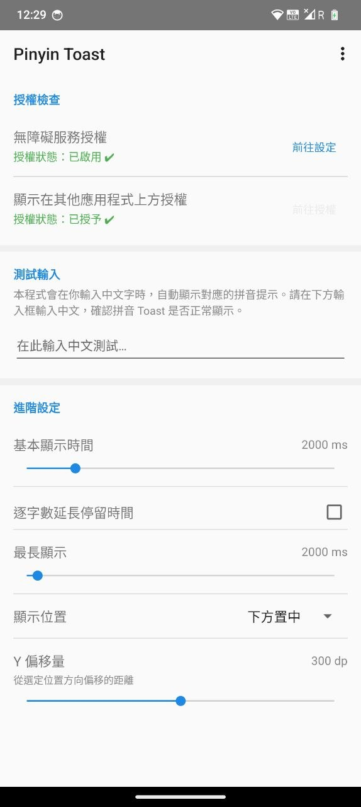
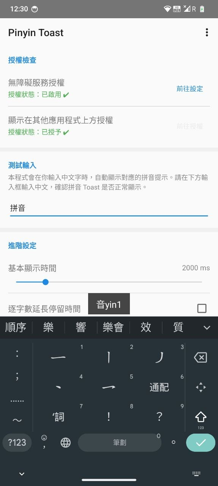
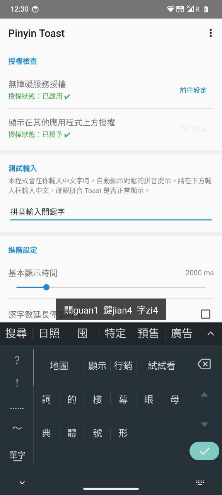

# PinyinToast

PinyinToast 是一個 Android 無障礙小工具，能在輸入漢字時即時在螢幕上顯示對應的拼音。本專案旨在幫助非拼音母語者（如粵語使用者）在日常使用中無縫學習拼音，以順利過渡至拼音輸入法。

[](https://www.android.com)
[](https://developer.android.com/studio/releases/platforms)
[](LICENSE)

## 背景與緣由

作者母語為粵語，長期使用筆畫輸入法，打字步數多，速度較慢。

現今使用 LLM 工具需要長篇對話，用筆畫一字一字打實在太累，也大幅降低效率。因此決定轉用拼音輸入法——但作為拼音並不熟練的粵語使用者，很多字都不懂拼。

**PinyinToast 就是為了解決這個過渡期而誕生的：** 用戶可保留原有輸入法，在打字時 PinyinToast 會透過全局懸浮窗顯示所打漢字的拼音。這樣能在不干擾日常使用的情況下，一邊打字一邊學習常用字的拼音，輔助完成輸入法的轉移。

---

## 主要功能

- **即時拼音顯示** — 每當你在任何 App 中輸入漢字，螢幕上會立即彈出一個拼音提示浮層
- **全域運作** — 透過 Android 無障礙服務（Accessibility Service）監聽文字輸入，在所有 App 中均可運作
- **可自訂顯示位置** — 支援 9 個位置（上/中/下 × 左/中/右），並可透過 Y 軸偏移精確調整
- **可自訂顯示時間** — 設定基礎顯示時間，並可開啟「按字元延長」模式（字越多，顯示越久），亦可設定最長上限
- **聲調數字標記** — 使用數字聲調（例：`你nǐ` → `ni3`），清晰易讀

---

## 📱 螢幕截圖

<div align="center">
  
  
  
</div>

---

## 🚀 安裝與使用

### 系統需求

- Android 7.0（API 24）或以上
- 需要授予兩項特殊權限（僅此而已）

### 使用設定

1. 從 [Releases](../../releases) 頁面下載最新版 APK，或參考下方說明自行編譯。
2. 安裝後開啟應用程式。
3. 依畫面指示完成兩項系統授權：
   - **無障礙服務 (Accessibility Service)**：允許 App 讀取畫面上的文字變動，以獲取輸入內容。注意，本程式僅讀取文字以進行本地拼音轉換，不會上傳或記錄數據。
   - **顯示在其他應用程式上層 (System Alert Window)**：允許 App 在全域繪製懸浮窗以顯示拼音。

設定完成後，在任何應用程式中輸入漢字即可看到效果。

## 開發與架構

本專案主要使用 Kotlin 開發，並整合 `pinyin4j` 處理拼音轉換邏輯。
- `MainActivity.kt`：負責權限狀態檢查、使用者偏好設定 (`SharedPreferences`) 及 UI 控制。
- `PinyinService.kt`：核心後台服務，實作 `AccessibilityService` 監聽 `TYPE_VIEW_TEXT_CHANGED` 事件，過濾 Unicode 漢字區段 (U+4E00–U+9FA5) 後轉換拼音，並透過 `WindowManager` 控制懸浮視窗的生命週期與動畫。

## 自行編譯
前置環境：
- Android Studio Hedgehog 或更新版本
- JDK 17

```bash
git clone https://github.com/your-username/PinyinToast.git
cd PinyinToast
./gradlew assembleDebug
```
編譯完成的 APK 位於 `app/build/outputs/apk/debug/app-debug.apk`。

## 技術支援與貢獻
- **問題回報**：若發現 Bug 或有新功能建議，請提交 [Issue](../../issues)。
- **參與貢獻**：歡迎發起 Pull Request。提交 PR 前，請確保程式碼風格與現有專案一致；若有重大結構更動，建議先開 Issue 討論。
- **維護者**：本專案由開源社群維護，歡迎貢獻者共同參與發展。

## 授權條款

本專案採用 [MIT License](LICENSE) 授權。
